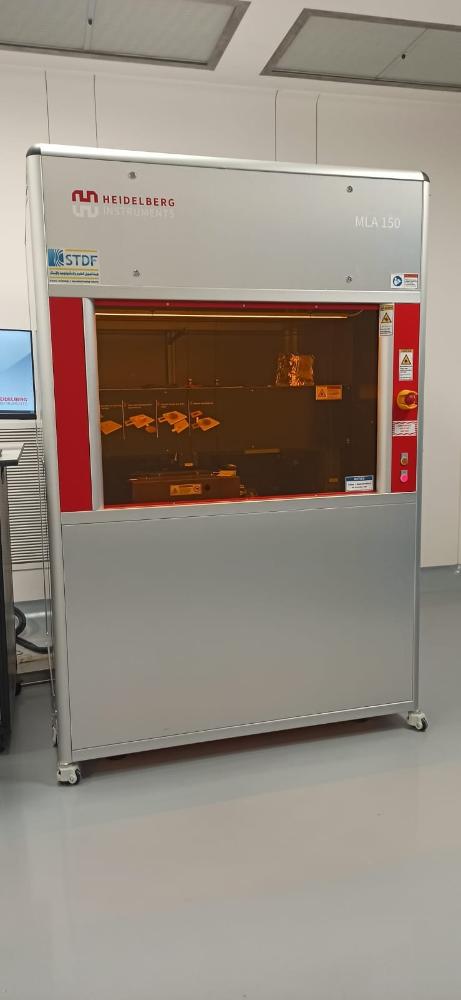

# Heidelberg Instruments MLA 150 — Maskless Aligner

**Process area:** Direct-write lithographic exposure

## Principle and role

The MLA 150 uses digital lithographic data to pattern photoresist without a physical photomask. The manufacturer describes digital-mirror-based exposure for microfabrication and MEMS-related research.

## Evidence and limits

A full photograph of the MLA 150 is supplied. No writing file, exposure process, wafer, developed pattern, or feature measurement is supplied.

## Lab photograph

## External source

- [Technical description / model reference](https://heidelberg-instruments.com/product/mla150/)

## Documentation status

Educational familiarization only; no user operation, fabricated device, settings, or validation data are claimed.

[← Back to repository overview](../../README.md)
