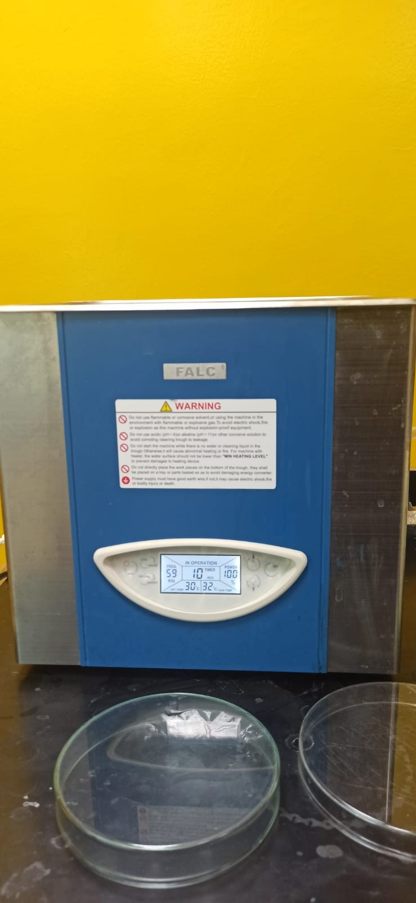
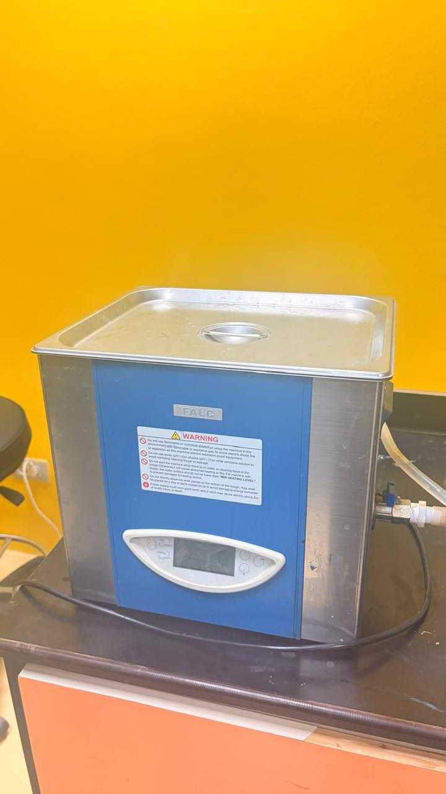
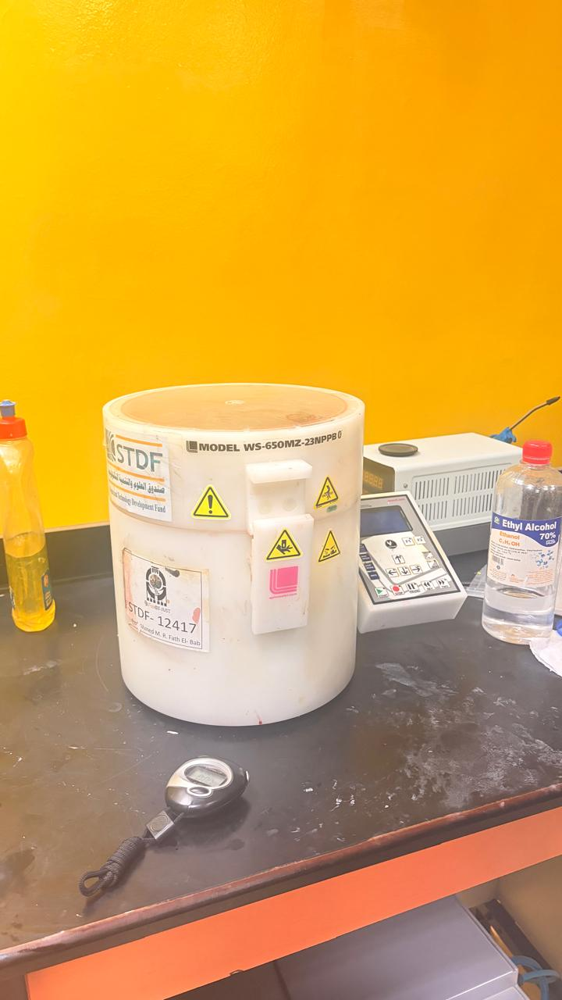
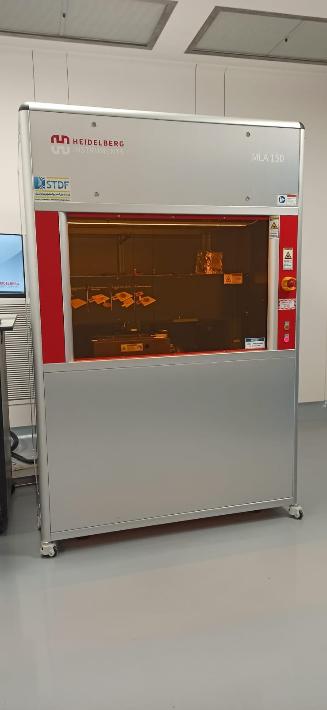
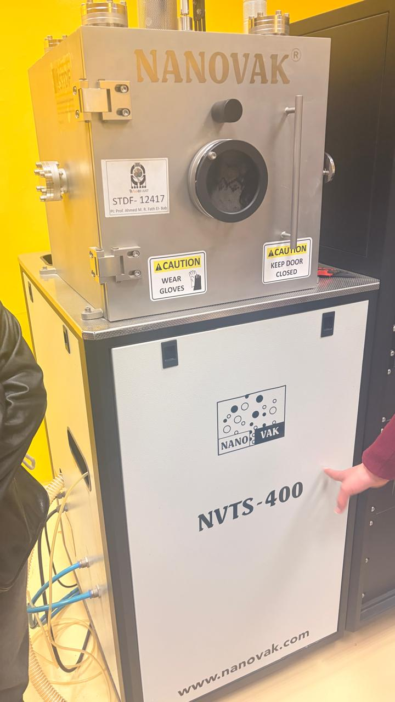
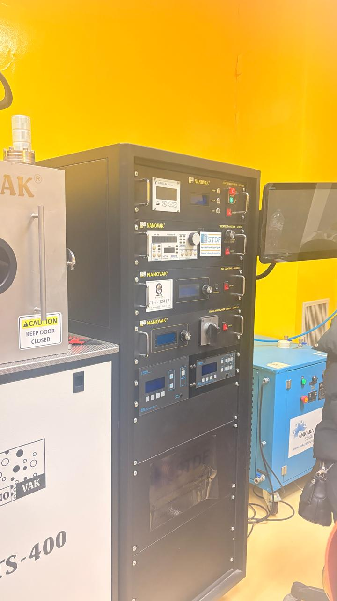
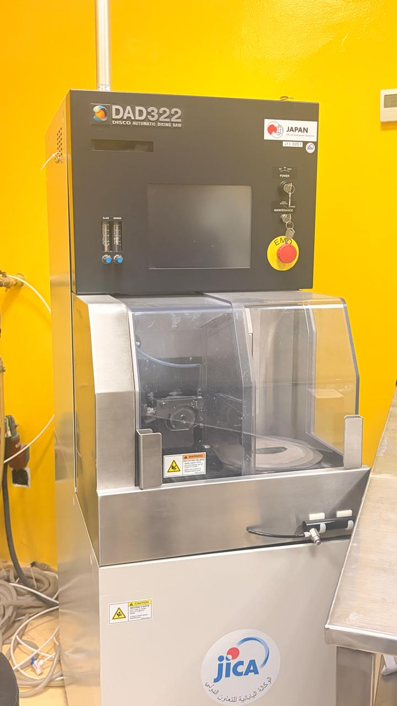
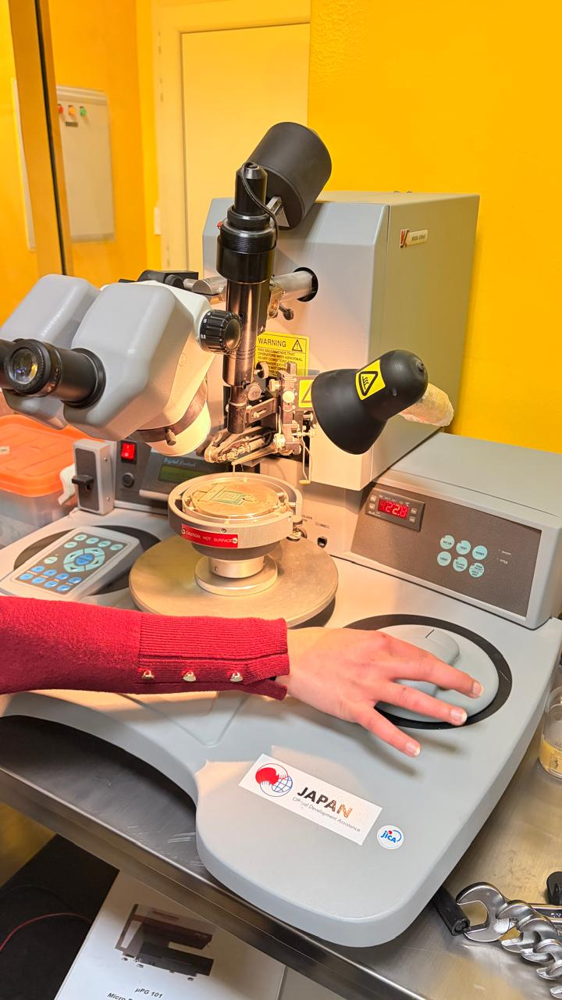
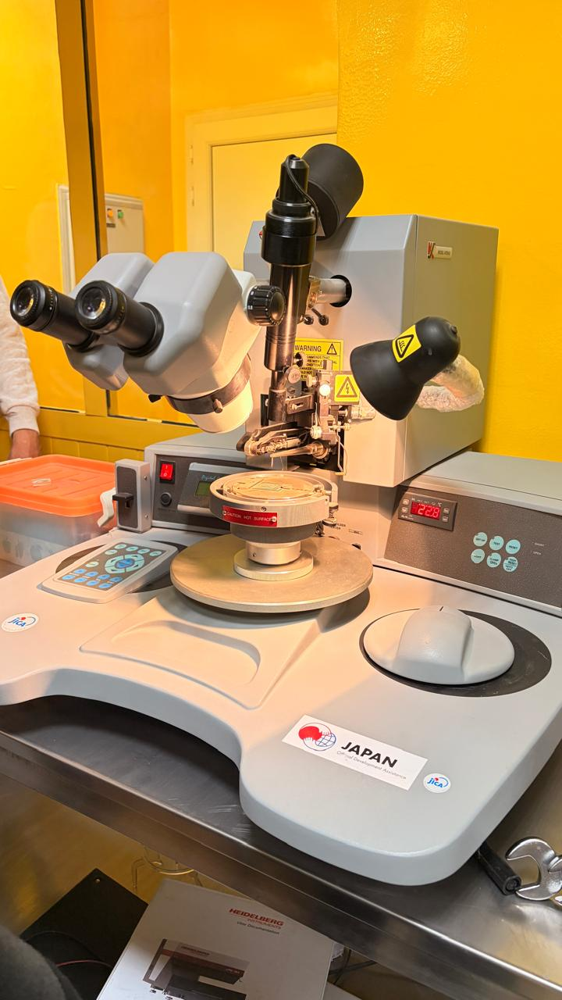
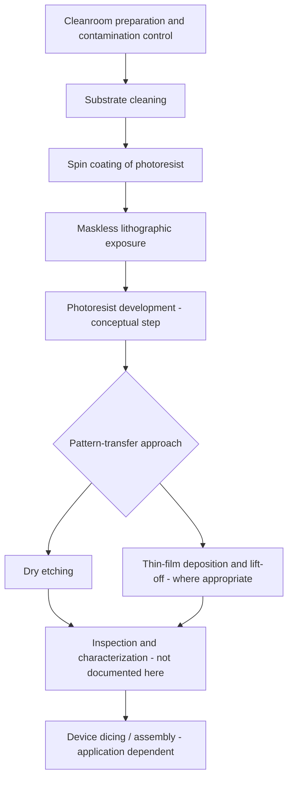

# MEMS Cleanroom & Microfabrication Lab — Equipment Exposure

**A documented learning experience in MEMS microfabrication, cleanroom practices, and semiconductor processing equipment.**

This repository organizes an educational MEMS-lab overview, my notes on the underlying process principles, and available equipment photographs. It connects the individual tools to the broader fabrication of microelectromechanical systems (MEMS), sensors, and thin-film devices.

> **Experience classification:** Educational lab exposure / equipment familiarization — **not** an independent device-fabrication project. This repository does **not** claim that I personally operated all the instruments, completed certified equipment training, or fabricated and tested a MEMS device. The photos document equipment present during the experience, not experimental results.

## What I studied

- Cleanroom contamination control and why particles and residues affect fabrication yields
- Substrate cleaning through ultrasonic cavitation
- Uniform photoresist coating using spin coating
- Direct-write, maskless photolithography for patterning
- Physical vapor deposition (PVD), including sputtering and thermal evaporation
- Dry etching as a pattern-transfer technique
- Adjacent processing and packaging tools: laser cutting/engraving, wafer dicing, and laser micro-soldering

## Photographs from the lab

These **10 original laboratory photographs** document the instruments and their visible components. Photos show equipment available in the laboratory; they are **not evidence of completed fabrication runs, formal training, or independent operation**.

### 1. Surface preparation — ultrasonic cleaning

| FALC ultrasonic bath — display / front panel | FALC ultrasonic bath — closed lid |
|:--:|:--:|
|  |  |

The FALC bath is used in laboratory cleaning workflows; the exact model **LBS 2** is from the supplied equipment list, not confirmed from the visible badge.

### 2. Photoresist coating — spin coater

**Laurell WS-650MZ-23NPPB:** used for spreading liquid coatings (including photoresist) into thin films by controlled spinning. The model identifier is visible on the unit.

### 3. Lithographic exposure — maskless aligner

**Heidelberg Instruments MLA 150:** direct-write photolithography equipment. A photograph of the instrument is **not** documentation of any pattern, developed photoresist, or measured resolution.

### 4. Thin-film deposition — NANOVAK system

| Vacuum/deposition chamber | Control rack |
|:--:|:--:|
|  |  |

**NANOVAK NVTS-400:** chamber, supporting controllers, and full system view. The more specific **NVTS-400-2TH2SP** configuration was supplied in the equipment list; it cannot be verified solely from the photos.

### 5. Wafer dicing — precision cutting

**DISCO DAD322 automatic dicing saw:** cuts wafers or substrates into smaller pieces/dies. The machine name and model are visible.

### 6. Microscope-assisted micro-assembly station

| Station during a demonstration | Station overview |
|:--:|:--:|
|  |  |

The supplied academic report calls this a **laser micro-soldering station**. However, its exact model and whether it uses laser-based joining **cannot be confirmed from these photographs**. It is therefore captioned conservatively as a *microscope-assisted micro-assembly station* pending confirmation.

**Not photographed:** Universal Laser Systems VLS 3.50 and the unspecified dry-etching machine were mentioned in the equipment list but are not shown in this photo collection.

> **Publication check:** Obtain laboratory approval before uploading identifiable equipment photographs, logos, or facility images to a public repository.

## Equipment overview

| Equipment | Model / identification | Role in the broader workflow | Documentation |
|---|---|---|---|
| Ultrasonic cleaner | FALC LBS 2 | Removes surface contaminants using acoustic cavitation | [Notes](docs/equipment/01-ultrasonic-cleaner.md) |
| Spin coater | Laurell WS-650MZ-23NPPB | Produces uniform photoresist or solution-cast films | [Notes](docs/equipment/02-spin-coater.md) |
| Maskless lithography | Heidelberg Instruments MLA 150 | Exposes patterns directly from digital layout data | [Notes](docs/equipment/03-mla150-lithography.md) |
| PVD deposition | NANOVAK NVTS-400-2TH2SP | Thin-film deposition using evaporation/sputtering processes | [Notes](docs/equipment/04-nanovak-deposition.md) |
| Dry etcher | **Model not documented** | Transfers patterns into materials through dry etching | [Notes](docs/equipment/05-dry-etching.md) |
| Laser cutting / engraving | Universal Laser Systems VLS 3.50 | Laser cutting/engraving for compatible materials and prototyping | [Notes](docs/equipment/06-vls350-laser.md) |
| Wafer dicing *(in original lab summary)* | DISCO DAD322 | Separates processed wafers/substrates into individual dies | [Notes](docs/equipment/07-dad322-dicing.md) |
| Reported laser micro-soldering / micro-assembly station *(in original lab summary)* | Model and operating principle unverified | Microscope-assisted micro-assembly; exact joining process not confirmed | [Notes](docs/equipment/08-micro-soldering.md) |

**Evidence note:** Equipment identities were taken from supplied notes/photos and a four-page student lab summary. They were not independently verified against the lab's inventory. Manufacturer references validate the **general functions** of instrument families; they do not prove local configurations, qualification, or access.

## Conceptual workflow

The diagram below is a **learning map**, not a proven fabrication recipe completed during this visit. Many processes use a different order or repeat coating, lithography, deposition, and etching.

For a discussion of what is and is not evidenced in this repository, see [Scope & evidence](docs/scope-and-evidence.md). For a deeper process overview, see [Microfabrication process map](docs/microfabrication-process-map.md).

## Main takeaways

1. **Contamination control is foundational.** Cleaning and cleanroom procedures must be considered throughout the process, not only before patterning.
2. **Lithography defines where material processing occurs.** The MLA 150 is a maskless exposure system; it is not a dicing or milling tool.
3. **Deposition and etching are complementary, but distinct.** Deposition adds thin films; etching removes selected material.
4. **Equipment configuration matters.** Capabilities of a published instrument model do not automatically describe the specific installation in a laboratory.
5. **Documentation should distinguish exposure from practice.** Without process logs, samples, settings, or measurements, the honest outcome is familiarity with methods and a process-level understanding—not demonstrated fabrication competence.

## Repository navigation

- [Photo index and identification notes](assets/equipment/PHOTO_INDEX.md)
- [Cleanroom and contamination basics](docs/cleanroom-basics.md)
- [Process map and method comparisons](docs/microfabrication-process-map.md)
- [Scope, evidence, and missing information](docs/scope-and-evidence.md)
- [Learning reflections and next steps](docs/learning-reflection.md)
- [External technical references](REFERENCES.md)
- [GitHub publishing checklist](GITHUB_UPLOAD_GUIDE.md)

## Context & acknowledgments

Prepared as an educational documentation/portfolio exercise based on a MEMS lab overview and photographs. The underlying lab summary was submitted in an E-JUST academic context. This is **not** an official university repository, laboratory operating manual, equipment qualification record, or endorsement from E-JUST, STDF, or any instrument manufacturer.

**Safety:** No chemical, laser, plasma, high-vacuum, high-voltage, or wafer-processing procedure should be performed from these notes. Follow the local lab's approved standard operating procedures, training requirements, and supervision.

**Photography/permissions:** Publish the equipment images only if the owner/host laboratory authorizes public dissemination. No raw student report is included because it contains personally identifying and course-related information.
