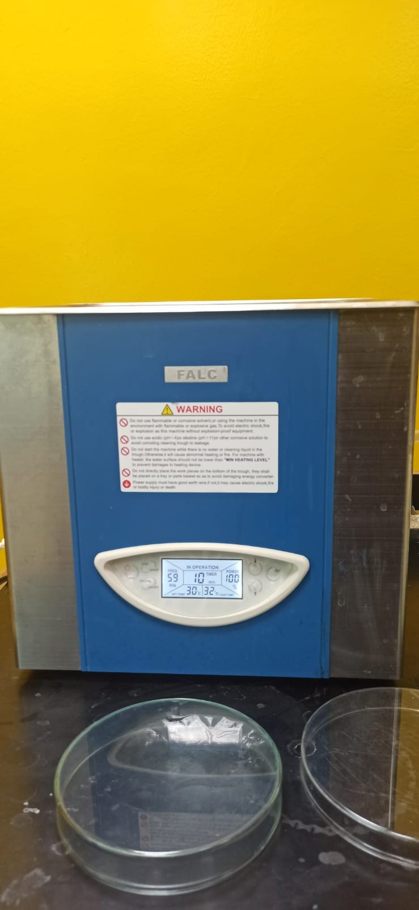
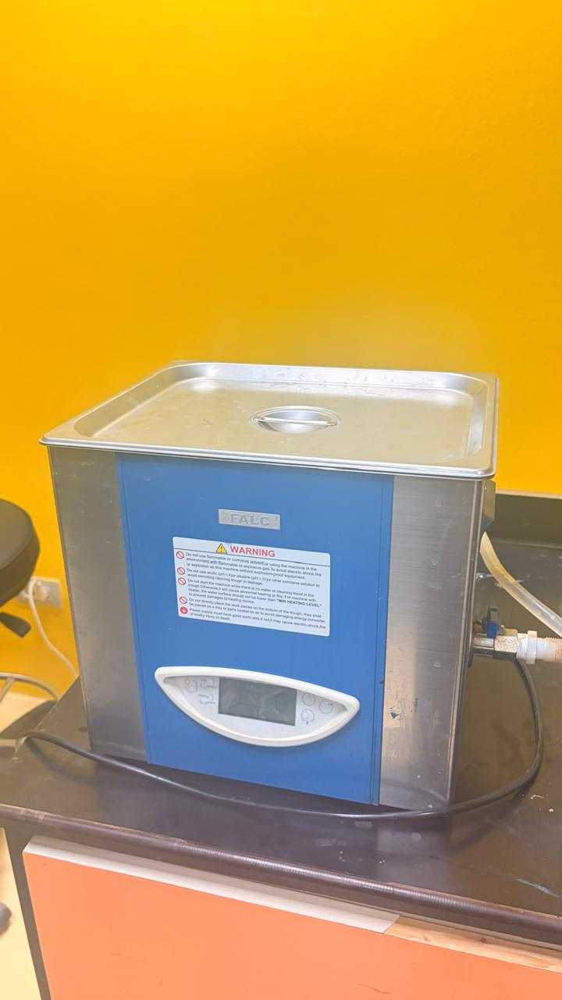

# FALC LBS 2 — Ultrasonic Cleaner

**Process area:** Cleaning

## Principle and role

An ultrasonic bath uses cavitation created by ultrasound in a liquid to loosen contaminants from components or substrates. In MEMS processing, substrate preparation can influence coating adhesion and defect risk.

## Evidence and limits

A FALC-branded ultrasonic bath is visible in the supplied photograph. The **LBS 2** family/model designation is supplied by the user; exact unit size and options have not been independently confirmed.

## Lab photograph

## External source

- [Technical description / model reference](https://falcinstruments.it/en/ultrasonic-baths/labsonic-lbs2-15)

## Documentation status

Educational familiarization only; no user operation, fabricated device, settings, or validation data are claimed.

[← Back to repository overview](../../README.md)
