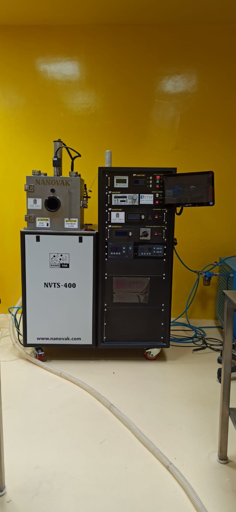
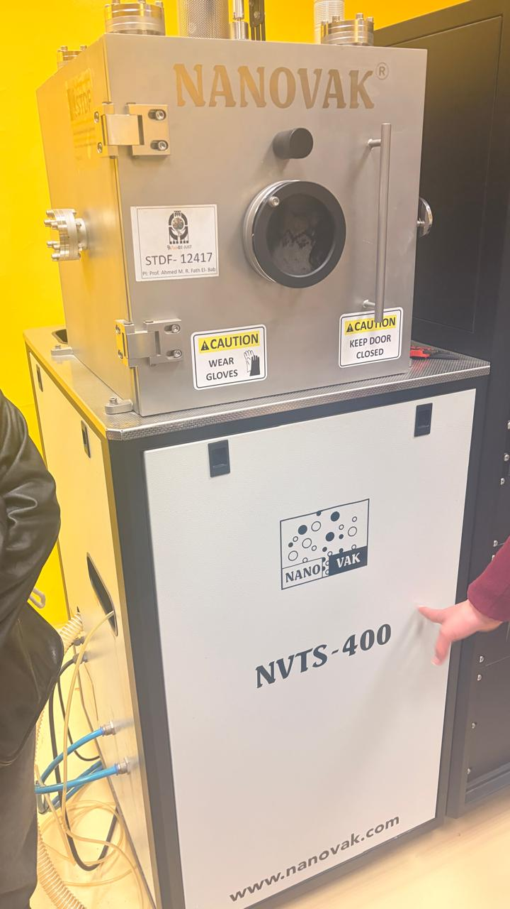
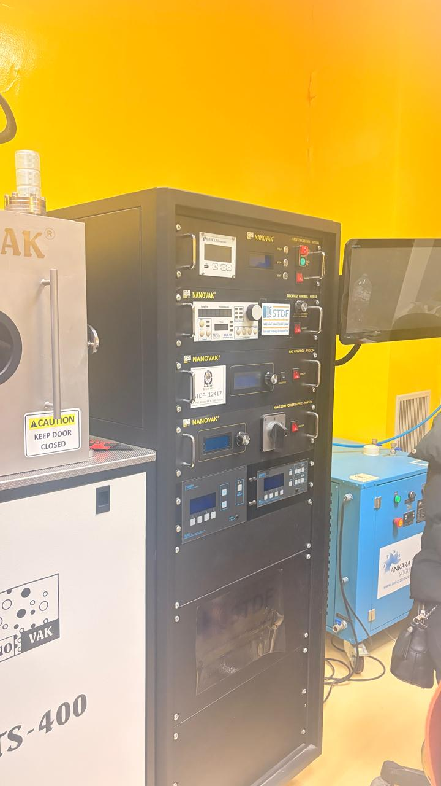

# NANOVAK NVTS-400-2TH2SP — Deposition System

**Process area:** PVD / sputtering / thermal evaporation

## Principle and role

Physical vapor deposition adds thin films under vacuum. **Sputtering** ejects target atoms through plasma bombardment; **thermal evaporation** vaporizes source material for deposition. An NVTS-400 2TH2SP configuration is described in a peer-reviewed methods section as supporting both techniques.

## Evidence and limits

A NANOVAK NVTS-400 installation is pictured and the model suffix is supplied by the user. The photographed lab configuration, targets, process parameters, and resulting films were not verified.

## Lab photograph

## External source

- [Technical description / model reference](https://link.springer.com/article/10.1007/s10856-020-06477-4)

## Documentation status

Educational familiarization only; no user operation, fabricated device, settings, or validation data are claimed.

[← Back to repository overview](../../README.md)
