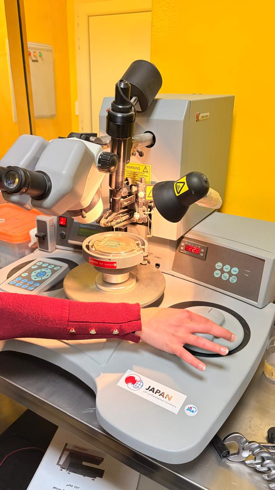
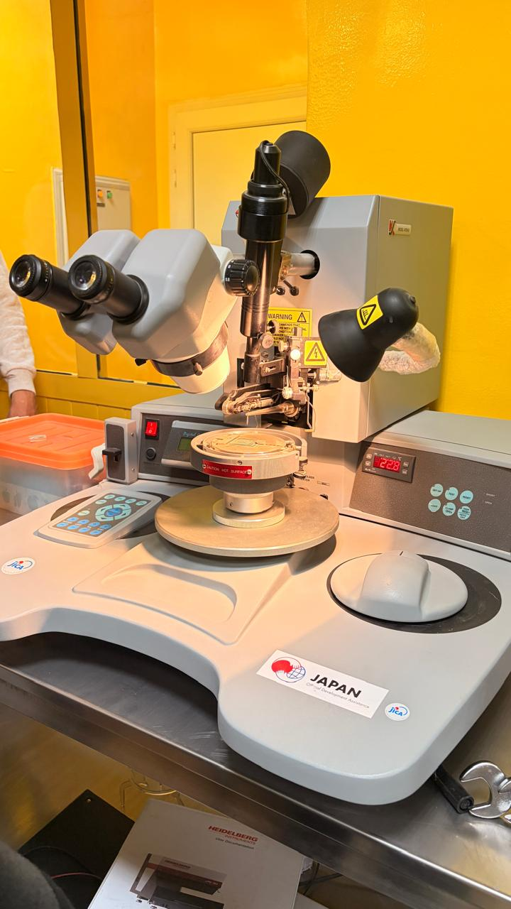

# Micro-Assembly Station (Reported as Laser Micro-Soldering)

**Process area:** Microelectronic assembly / joining (exact process not verified)

## Principle and possible role

The supplied four-page academic lab summary labels the pictured setup a **laser micro-soldering station** and describes localized optical solder heating as a micro-assembly method. The newly supplied photographs show a binocular microscope, a mounted toolhead, a stage and a nearby controller, but these visible details **do not establish that the photographed machine uses a laser**. It may be an alternative micro-joining instrument. Its model number and operation need confirmation with the lab before a more specific identification is published.

## Evidence and limits

The equipment photos document the physical setup, not the exact soldering/bonding process, a completed joint, device tests, or personal operation. No operating parameters or manufacturer documentation were supplied for this particular station.

## Lab photographs

## Documentation status

Educational familiarization only; equipment type is **provisional** until the model/technique are confirmed.

[← Back to repository overview](../../README.md)
